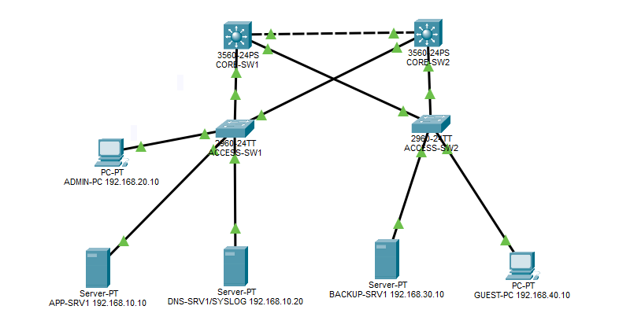

# Data Centre Network Operations Lab

## Project Overview

This project demonstrates the design, configuration and basic operation of a simulated data centre network using Cisco Packet Tracer.

The lab focuses on network segmentation, inter-VLAN routing, gateway redundancy, access control, network services and centralised logging.

It was developed as a hands-on portfolio project to strengthen practical networking, infrastructure operations and troubleshooting skills.

## Network Topology



## Project Objectives

- Design a redundant network topology using two Layer 3 core switches and two access switches.
- Segment the network using VLANs.
- Enable communication between authorised internal networks.
- Restrict guest access to internal resources using ACLs.
- Configure HSRP to provide redundant default gateways.
- Deploy DHCP and DNS services.
- Configure secure SSH management on CORE-SW1.
- Implement centralised Syslog monitoring.
- Practise basic network verification and troubleshooting.

## Network Infrastructure

| Device | Model | Role |
|---|---|---|
| CORE-SW1 | Cisco 3560 | Primary Layer 3 switch |
| CORE-SW2 | Cisco 3560 | Secondary Layer 3 switch |
| ACCESS-SW1 | Cisco 2960 | Access layer switch |
| ACCESS-SW2 | Cisco 2960 | Access layer switch |
| APP-SRV1 | Server | Application server |
| DNS-SRV1 | Server | DNS and Syslog server |
| BACKUP-SRV1 | Server | Backup network server |
| ADMIN-PC | PC | Administrative workstation |
| GUEST-PC | PC | Guest network client |

## VLAN and IP Addressing

| VLAN | Network | Purpose | HSRP Virtual Gateway |
|---|---|---|---|
| 10 | 192.168.10.0/24 | Server Network | 192.168.10.1 |
| 20 | 192.168.20.0/24 | Admin Network | 192.168.20.1 |
| 30 | 192.168.30.0/24 | Backup Network | 192.168.30.1 |
| 40 | 192.168.40.0/24 | Guest Network | 192.168.40.1 |

## Technologies Implemented

### VLANs and Trunking
Configured four VLANs and IEEE 802.1Q trunk links to separate traffic across different network segments.

### Inter-VLAN Routing
Enabled Layer 3 routing through Switch Virtual Interfaces (SVIs), allowing authorised communication between VLANs.

### Spanning Tree Protocol (STP)
Configured bridge priorities to establish a preferred root bridge and provide Layer 2 path redundancy.

### Hot Standby Router Protocol (HSRP)
Configured Active and Standby default gateways for all four VLANs, with preemption enabled. Performed gateway failover testing.

### Access Control Lists (ACLs)
Implemented an extended ACL to restrict Guest VLAN access to the Server, Admin and Backup networks.

### DHCP and DNS
Configured DHCP address allocation for guest clients and DNS name resolution for the application server.

### SSH Remote Management
Configured SSHv2 and management access restrictions on CORE-SW1.

### Centralised Syslog
Configured both core switches to forward system events to a central Syslog service hosted on DNS-SRV1.

## Network Monitoring and Troubleshooting

Practised basic operational checks using Cisco IOS commands, including:

```text
show ip interface brief
show interfaces gigabitEthernet 0/1
show vlan brief
show interfaces trunk
show standby brief
show logging
show ip dhcp binding
```

Troubleshooting activities included checking connectivity between CORE-SW2 and the Syslog server and verifying the delivery of newly generated log events.

## Tools Used

- Cisco Packet Tracer
- Cisco IOS CLI
- Visual Studio Code
- Git and GitHub

## Project Files

- `AI_Data_Centre_Network_Operations.pkt` — Packet Tracer lab
- `configs/` — Network device configurations
- `screenshots/` — Network topology and test evidence
- `docs/` — Network design documentation
- `troubleshooting/` — Troubleshooting records

## Project Scope and Limitations

This project was developed in Cisco Packet Tracer rather than a production data centre environment.

Some monitoring and hardware-related features may differ from physical Cisco equipment.

SSH management was implemented on CORE-SW1. DHCP is currently hosted on CORE-SW1, and DHCP service redundancy has not been implemented.

## Author

Cybersecurity graduate with hands-on experience in software development, IT infrastructure and incident response, building practical skills in network operations and security.